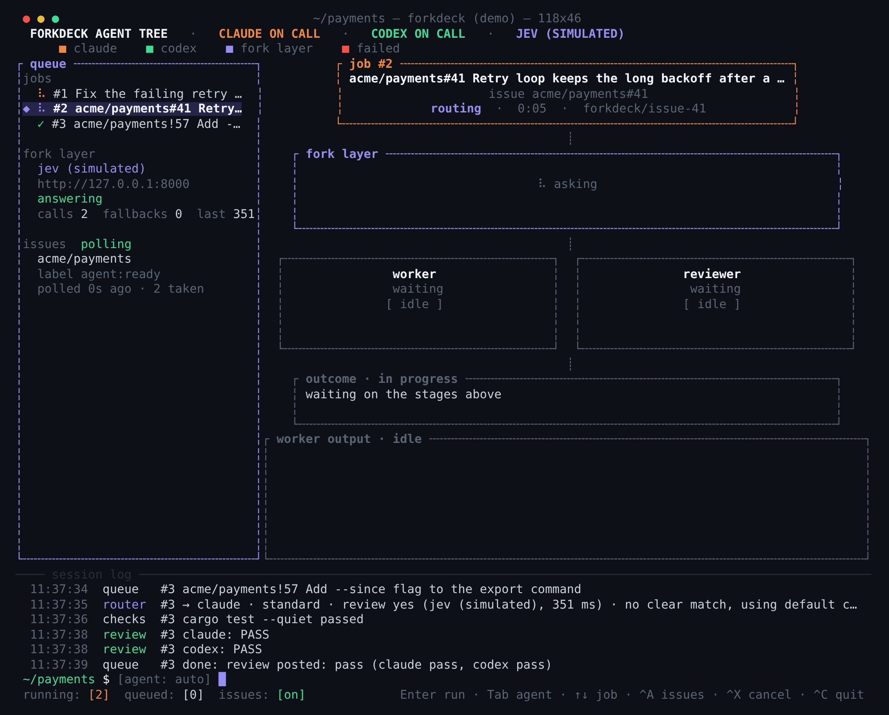

# forkdeck

A terminal agent tree for the `claude`, `codex` and GitHub Copilot (`copilot`) CLIs.

You give it a task, or label an issue, and it decides which CLI should do the
work and at what effort, runs it, has the *other* CLI review the result, and
shows the whole thing as a live tree.



It drives the official CLIs as subprocesses, so it uses whatever login they
already have, subscription or API key. It never talks to a model API itself.
The one network call it makes on its own is to the decision endpoint, and that
can be a server on your own machine.

## Install

```sh
cargo install --git https://github.com/forkdeck/forkdeck
```

Or download a static Linux binary from the
[releases](https://github.com/forkdeck/forkdeck/releases).
See [installation](docs/install.md) for checksums and requirements.
You need at least one of `claude`, `codex` and `copilot` on your PATH, logged in.

## Five-minute quick start

```sh
forkdeck --demo      # simulated agents, nothing is executed; Ctrl-Q quits
forkdeck doctor      # what is installed and reachable
forkdeck init        # writes ~/.config/forkdeck/config.toml, fully commented
```

Then open a clone you want to work in and start `forkdeck`. Type a task and
press Enter. The chosen agent works in that directory, configured checks run, and a reviewer
reads the result. Enter sends a follow-up; Ctrl-T starts a new task; Ctrl-Q quits.
See [terminal controls](docs/terminal.md) and [how a job runs](docs/jobs.md).

For the browser board, run `forkdeck serve` in the clone and open
<http://127.0.0.1:7420/>. There is no login by default. The browser is read-only;
use the terminal to start work. `forkdeck serve --demo` shows seeded native jobs.
See [web UI and daemon](docs/web-ui.md) for server settings and optional OIDC.

Issue automation needs `gh` and/or `glab`, logged in, and a configured repository.
Read [configuration](docs/configuration.md) and [issues and pull requests](docs/issues-and-prs.md)
before turning polling on.

## Documentation

The [documentation index](docs/README.md) includes every guide and existing design plan.

| Topic | Guide |
|---|---|
| Setup | [Install](docs/install.md) · [Configuration](docs/configuration.md) |
| Jobs and agents | [Job lifecycle](docs/jobs.md) · [Agents and Copilot](docs/agents.md) · [Routing](docs/routing.md) |
| Daily use | [Terminal, conversations and history](docs/terminal.md) · [Planning](docs/planning.md) · [Sub-issues](docs/sub-issues.md) |
| Forge automation | [Issues and PRs](docs/issues-and-prs.md) · [Team coordination](docs/team.md) · [CI and deploys](docs/ci-and-deploys.md) |
| Guardrails | [Sandbox and network](docs/sandbox-and-network.md) · [Limits](docs/limits.md) · [Repository notes](docs/knowledge.md) |
| Browser and phone | [Web UI and OIDC](docs/web-ui.md) · [Android remote](docs/remote-phone.md) |
| Usage | [Metrics and stats](docs/metrics-and-stats.md) · [Adaptive routing](docs/adaptive-routing.md) |
| Contributing | [Development and status](docs/development.md) · [Testing](docs/testing.md) · [Troubleshooting](docs/troubleshooting.md) |

[MIT license](LICENSE).
