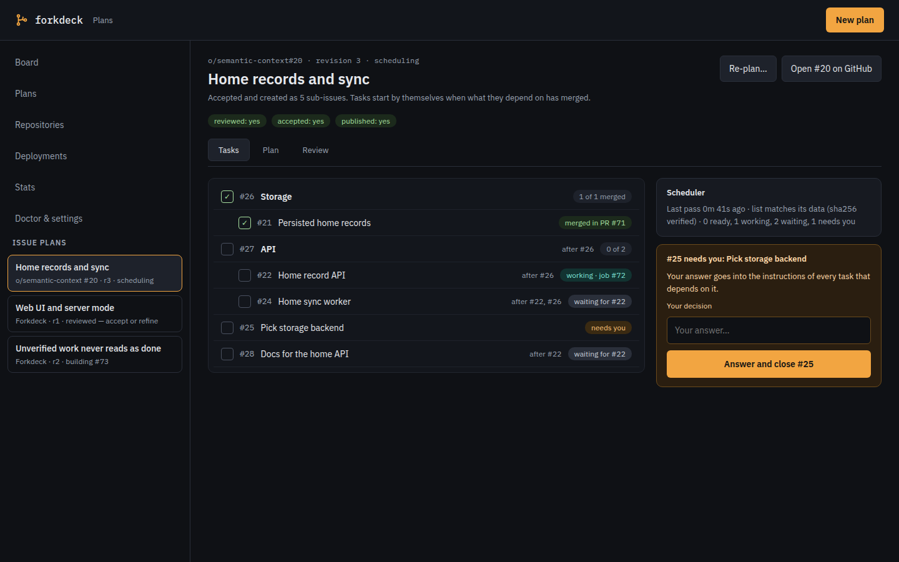

[Documentation](README.md) · [Front page](../README.md)

# Planning

## Planning first

With `Ctrl-P` or `Shift-Tab` before `Enter` (or `forkdeck run --plan`), the agent first looks at
the code without changing anything and proposes two to four approaches, marking
the one it recommends. Type a number and press Enter, or type how you want it done
instead; the same agent then does it, in the conversation it planned in. With a
decision server, the fork layer can also ask for a plan on open-ended tasks
(`router.plan = "auto"`, the default; `"never"` turns that off). Issue jobs
have nobody to ask, so they take the recommended option, and the pull request
says which one and what else was proposed.

A number sent during planning is saved as an early choice; other messages remain guidance for the worker. When headless input closes, a waiting plan takes its recommended option.

If the agent asks a question instead of proposing approaches, its question is
shown in the worker's box; type the answer and press Enter. While a task waits
for your choice it holds nothing up: other typed tasks in the directory run
meanwhile, and the waiting task's change is measured from where the directory
is when it carries on.

After `Enter` starts a task, the input box replies to it; `Ctrl-T` starts another.

Typed tasks share the current directory, so they run one at a time. Issue and
review jobs each have a worktree and run `automation.max_parallel` at once.

`forkdeck run "task"` does one job without the interface: lines you type while it
runs are sent to the task, and a line starting with `!` stops the agent to take
it at once. `forkdeck once` does one pass over the configured repositories. Both exit non-zero if a job
fails and stop their agents on SIGTERM or SIGINT, which is enough for a script
or a cron entry.

## Issue-backed planning

Press **Ctrl-T**, then **F6** to start a plan for a configured GitHub or GitLab
repository. F6 on a completed typed task attaches issue planning to that same
conversation. Choose the repository with Left/Right; the current directory's
matching repository is selected by default. Tab moves between the repository,
existing issue URL/number, and planning request. Leave the issue field blank to
create a new issue after acceptance. Enter starts planning.

The planner and plan reviewer both use the configured read-only agent arguments.
They review the goal, steps, acceptance criteria, dependencies and test strategy;
repository code checks run later during Build. A complete plan goes to review
even when ordinary task review is disabled. A failed review goes back to the
planner with its findings, and the revised plan is reviewed again, up to
`review.max_fix_rounds` times; it stops sooner when the plan needs a decision from
you, a revision changes nothing, or you have sent a message. A failed or incomplete
review cannot be accepted. Numbered choices and custom replies continue on the same task.

F6 shows the complete saved plan and reviewer feedback. Tab switches between
them; Up/Down and PageUp/PageDown scroll. Left/Right or 1–3 selects an action,
and Enter applies it:

1. **Accept and publish / retry** creates or updates the issue only after the
   current revision passes review. This also reconciles an interrupted publication.
2. **Refine** returns to the same task's message field for a custom response.
   Queued feedback receives its own planning/review turn and invalidates approval.
3. **Ready for build** applies the repository's existing intake label only after
   the current revision is reviewed, accepted and successfully published.

Publishing never starts Build by itself. The ordinary issue poller handles Ready
issues, using its existing author, budget, claim and concurrency checks. The
planning card links to that issue and shows the resulting build task number in
the current session. If intake is paused, the card says **Ready — intake paused**;
Ctrl-A enables intake when desired. The workflow never enables it automatically.
Refining a linked issue removes its ready label before planning starts. Closed,
actively claimed, building and PR-open issues cannot be refined or republished.

Plans occupy a `<!-- forkdeck:plan:start -->` / `<!-- forkdeck:plan:end -->`
section in the issue description. Text outside that section is preserved, and
each accepted revision adds a short history comment. Forkdeck re-fetches before
publication and refuses to overwrite a changed managed section. Refine to load
the latest issue and review the new revision. These checks are optimistic:
GitHub/GitLab issue edits and labels are not a cross-client transaction.

The issue reference, full draft/review, revision approvals and publication
progress are saved in the history database before remote writes. Restarting never
publishes: unlike other typed tasks, an interrupted issue plan is not resumed by
itself. Retry from F6 after a partial failure.
Uncertain issue/comment creation is reconciled through durable hidden markers;
if the result cannot yet be found, retry reports uncertainty instead of issuing
a duplicate POST. Keep those markers while recovering an interrupted operation.
A failed save blocks remote writes. One forkdeck at a time works on a task (it
takes the task over in the database); separate machines still use the forge's
claim checks.

This uses existing `gh` / `glab` authentication and the selected clone's CLI host
configuration. URL links must match that forge and repository. New issue plans
are local until acceptance; linking an existing ready issue immediately holds it
out of intake. Jira and other providers, issue-comment commands and headless
planning commands are not part of this first version.

For plans split across several issues, see [sub-issues](sub-issues.md).
Offline acceptance commands are in [testing](testing.md#issue-planning).

See the [desktop, phone and real-history captures](screenshots/README.md).
