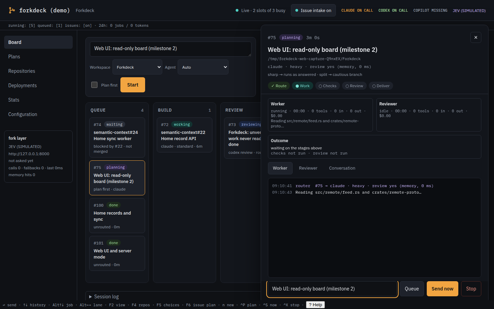
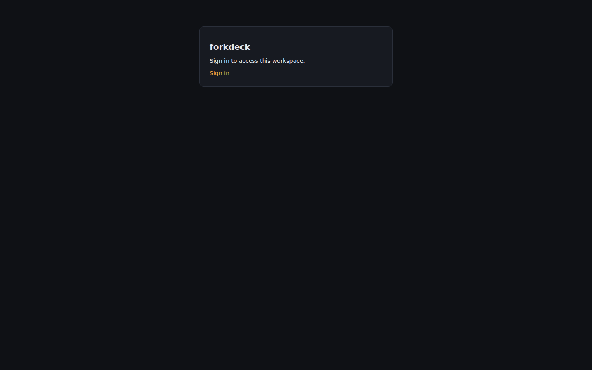

# Web UI captures

Captured from the production bundle through real API endpoints. Default local mode
has no login; no browser response fixtures, sample view patches or interceptors are used.

Build and capture from the repository root:

```sh
pnpm --dir web run build
cargo build
node web/scripts/screenshots.mjs
python3 web/scripts/compare-screenshots.py
```

Requires Node, Cargo, OpenSSL, Playwright Chromium and Pillow for the comparison.
`CHROMIUM_PATH` and `FORKDECK_BIN` override the browser and daemon executables.
Each image is a viewport capture at the dimensions in its filename. Long lists,
logs and prose scroll within their panels; the desktop board scrolls horizontally
through its six lanes. The script checks page overflow, visible reply controls,
JavaScript errors, live connections and unchanged source-file hashes.

## Demo Hub

`forkdeck serve --demo` seeds native Hub jobs, plans, task graphs, repository facts,
deployments and metrics in `src/server/seed.rs`. These are projected by the same
API code as normal service data. The board selects an active typed job, with unsent drafts from its native prompt to
show the available write controls; detail selects
an unverified job. Plan captures select a graph when available, then click each tab. The demo capture
toggles intake through HTTP and restores it before capturing, so Configuration shows actual
audit entries. Publication and decision controls retain their native eligibility reasons.

| Screen | Desktop · 1440×900 | Phone · 390×844 |
| --- | --- | --- |
| Board | [View](board-1440x900.png) | [View](board-390x844.png) |
| Detail | [View](detail-1440x900.png) | [View](detail-390x844.png) |
| Plans Tasks | [View](plans-tasks-1440x900.png) | [View](plans-tasks-390x844.png) |
| Plans Plan | [View](plans-plan-1440x900.png) | [View](plans-plan-390x844.png) |
| Plans Review | [View](plans-review-1440x900.png) | [View](plans-review-390x844.png) |
| Repos | [View](repos-1440x900.png) | — |
| Deploys | [View](deploys-1440x900.png) | — |
| Stats | [View](stats-1440x900.png) | — |
| Configuration | [View](configuration-1440x900.png) | — |



## Private real history

The script copies `~/.local/state/forkdeck/forkdeck.db` and its WAL into a private
temporary `XDG_STATE_HOME`. It also copies journal, deployment state and metrics
attempts when present. It runs normal `forkdeck serve`, with intake, native remote
transport, model discovery and agent executables disabled. No copied records are
rewritten to create a desired state. Original files are hashed before and after;
the temporary workspace, config and state are deleted when the daemon stops.

This history restores 69 jobs and one plan. Its plan has no observed task graph;
Tasks therefore shows an explicit empty state, Plan shows the stored draft and
Review shows the retained review with its revision warning. The isolated config
has no repositories or deployment targets, so those pages show honest empty states.
Stats use the copied native journal and attempt records. No demo content is added.

| Screen | Desktop · 1440×900 | Phone · 390×844 |
| --- | --- | --- |
| Board | [View](real-board-1440x900.png) | [View](real-board-390x844.png) |
| Detail | [View](real-detail-1440x900.png) | [View](real-detail-390x844.png) |
| Plans Tasks | [View](real-plans-tasks-1440x900.png) | [View](real-plans-tasks-390x844.png) |
| Plans Plan | [View](real-plans-plan-1440x900.png) | [View](real-plans-plan-390x844.png) |
| Plans Review | [View](real-plans-review-1440x900.png) | [View](real-plans-review-390x844.png) |
| Repos | [View](real-repos-1440x900.png) | — |
| Deploys | [View](real-deploys-1440x900.png) | — |
| Stats | [View](real-stats-1440x900.png) | — |
| Configuration | [View](real-configuration-1440x900.png) | — |

## Optional OIDC

The existing Rust auth test fake provider performs discovery, JWKS verification,
PKCE, code exchange and group mapping. An ignored `screenshot_provider` test exposes
it to the browser through a temporary loopback HTTPS proxy, with an isolated session
database and native demo Hub structures. The certificate, provider and state are
removed afterward. This fixture does not change default no-login service behavior.

- [Forkdeck sign-in landing page](oidc-sign-in-1440x900.png) — existing `/auth/logout` page.
- [Signed-in desktop header](oidc-board-1440x900.png) — actual provider session.
- [Signed-in phone header](oidc-board-390x844.png) — user name and sign-out control.



## Visual reference and terminal images

Colours, IBM Plex fonts, spacing, pills and panels follow the
[approved mockups](../web-ui-mockup/README.md). `comparison.json` records measured
pixel differences against those reference renders, plus image sizes and hashes.
Content is intentionally derived from the Hub: current stage, availability,
elapsed time, route source, observation age, scheduler facts and review revision
can differ from the static design. These are not pixel-identical content comparisons.

The existing [terminal](terminal.png) and [team pane](team.png) images were moved
here from the docs root; they document the TUI and are separate from the web capture run.
