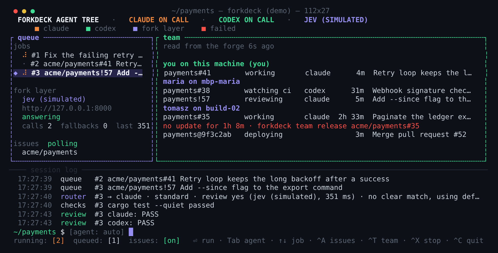

[Documentation](README.md) · [Front page](../README.md)

# Working as a team

When several people run forkdeck against the same repositories, each machine
needs to know what the others have taken, and people want to see it too. With
`[team]` enabled, forkdeck keeps that on GitHub or GitLab itself. There is no
server to run and nothing to sign up for; whoever can see the repository can
see who is on what.

```toml
[team]
enabled = true
```

**What it does.** Before forkdeck takes a labelled issue or pull request, it
posts one comment saying so, and assigns the issue to the account `gh` or
`glab` is logged in as. That comment is edited in place as the job moves
through routing, working, review, fixing, publishing and watching CI, and once
more when it ends.
A deployment is announced the same way on the commit being deployed (GitHub
only: GitLab commit comments cannot be edited).

**What is shared.** The account name, the machine name, which agent, which
stage, when it started, when it was last updated, and the pull request link.
No prompt, no agent output, no logs. Tasks typed into the prompt are never
shared.

The machine name is your hostname on private repositories. On a public
repository no machine name is posted, and if forkdeck cannot find out whether a
repository is public it posts none. To show a name there anyway, set `host` to
a label of your choosing; it is used as written. Each machine also puts a
random id into its claims, kept in `~/.local/state/forkdeck/machine-id`, so a
restarted forkdeck can recognise a claim its previous run left behind. The id
is not derived from anything about the machine.

**Seeing it.** `F4` swaps the agent tree for the team pane, and
`forkdeck team` prints the same thing:



```
alice on mbp-alice (you)
  payments#41        working       claude      4m  Retry loop keeps the long backoff after a success
maria on mbp-maria
  payments#38        watching ci   codex      31m  Webhook signature check rejects rotated keys
  payments!57        reviewing     claude      5m  Add --since flag to the export command
tomasz on build-02
  payments#35        working       claude  2h 33m  Paginate the ledger export
                     no update for 1h 8m · forkdeck team release acme/payments#35
  payments@9f3c2ab   deploying                 3m  Merge pull request #52
```

`#` is an issue, `!` a pull request, `@` a deployment. It reads the working
labels of every configured repository, so it also shows items someone claimed
by hand or with sharing off, as "no status". `--all` adds
issues whose pull request is open and waiting, and `--json` prints the rows
for scripts. Looking never changes anything, and works with sharing off.

**Not stepping on each other.** An issue or review that a teammate's forkdeck
holds is left alone: no label moves, no comment, and the job ends as "not
started". If two machines take the same issue in the same second, both see
both claims when they look again after moving the label, and the older
comment wins on both. If the claims cannot be read, nothing is taken.

**Who can claim and release.** The comments are read back from threads anyone
may write in, so a claim or a release only counts when the forge itself says
its author works on the repository: on GitHub the comment's author is the
owner, an organisation member or a collaborator; on GitLab a project member
with the Developer role or above. The comment also has to be written by the
account it names. Someone who can only comment cannot hold an issue or end a
teammate's claim by typing a marker.

**A claim is a lease.** Holding the item means holding the oldest claim that
is still being refreshed, and forkdeck checks exactly that before everything
it writes: the push, the pull request, the review, labels, and failure
reports. A job that finds its claim ended, overtaken, expired or unreadable
writes nothing more to the item and leaves its labels to whoever holds it now.

**When a machine goes away.** A running job refreshes its comment every
`heartbeat_secs`. A claim that has not been refreshed for `stale_mins` (the
forge's own "last edited" time, not a clock in the comment) is shown as stale
and no longer blocks anyone. Its label is still on the working one, so hand it
back:

```sh
forkdeck team release acme/payments#35      # an issue
forkdeck team release acme/payments!57      # a review
```

That ends the claim with a comment and puts the request label back, and the
next poll, yours or a teammate's, picks it up. A claim that is still being
refreshed needs `--force`. The machine that held it notices the next time it
is about to write anything, and stops without touching the labels.

Only an item that carries the working label is handed back, so releasing
something already finished does not queue it again. An item with that label
and no forkdeck claim (claimed by hand, or by a forkdeck with sharing off)
needs `--unclaimed`. An issue whose pull request is already open is not
handed back; close or take over the pull request instead.

A machine that was suspended, or cut off from the forge, for longer than
`stale_mins` comes back to an expired claim. It stops there rather than
publishing work someone else may have redone; hand the issue back and let it
run again.

Every machine that works a repository should have `[team]` enabled: a forkdeck
with sharing off neither announces what it takes nor looks at what others
have. Staleness compares the forge's time with this machine's clock, so a
clock that is far ahead makes teammates look stale. On GitHub, "organisation
member" is what the forge reports for the comment; a member the organisation
has given no write access to the repository still counts. Deployments are announced on the forge
but decided by the deployment system: each machine asks it before triggering
and does not start a commit that is already deployed or rolling out. A machine
that sees a teammate's announcement first also waits a moment before starting.
Two machines that ask in the same second can still both trigger, so the
`trigger` tool should be safe to call twice for the same commit, or the deploy
stage should live on one machine.
