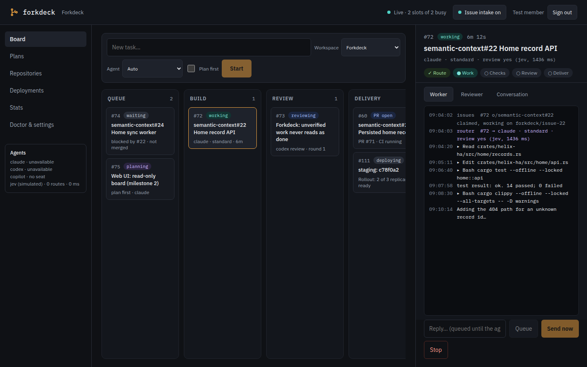

# Optional OpenID Connect access

Without `[web.oidc]`, Forkdeck keeps its existing no-login behavior. With it, every
page, asset, and `/api` route requires an authorized session. The three `/auth`
routes implement sign-in, callback, and sign-out. The native paired-phone protocol
is separate and retains its existing authentication. OIDC requires normal
`forkdeck serve` with durable history; the isolated `--demo` server has no session
database and refuses OIDC configuration.

Serve the browser origin through an HTTPS reverse proxy to Forkdeck's HTTP port.
Register a **confidential web application**, enable authorization code and PKCE
S256, use signed ID tokens, and register exactly the public callback URL. Forward
cookies, query strings, and SSE without buffering. Do not expose an alternative
unauthenticated proxy route. Forkdeck uses its configured callback URL, not forwarded
headers, to construct authorization requests and validate the logout Origin.

```toml
[web]
bind = "127.0.0.1"
port = 7420

[web.oidc]
issuer = "https://identity.example/realms/work"
client_id = "forkdeck"
client_secret_env = "FORKDECK_OIDC_SECRET"
redirect_url = "https://forkdeck.example/auth/callback"
scopes = ["openid", "email", "profile", "groups"] # default
# Nested example: "realm_access.roles"
groups_claim = "groups"                          # default
session_lifetime_secs = 43200                     # default: 12 hours

[web.oidc.roles]
viewer = ["forkdeck-readers"]
operator = ["forkdeck-operators"]
admin = ["forkdeck-admins"]
```

Supply `FORKDECK_OIDC_SECRET` in the daemon's environment using your service's secret
management. The config contains only its variable name. Empty/missing secrets,
invalid URLs, invalid scopes/claim paths, an empty access mapping, and invalid
lifetimes fail startup. The callback must be HTTPS at `/auth/callback`; the issuer
must be HTTPS except for a loopback test provider. Discovery uses the issuer's
`/.well-known/openid-configuration`, checks the issuer, and fetches JWKS. Discovery
and JWKS are cached for one hour and refreshed on an unknown signing key ID.
Provider requests have a 15-second timeout and do not follow HTTP redirects.

Groups must be a JSON array of strings. Values match exactly, including case and
any leading slash. Forkdeck first reads the configured dotted claim path from the
verified ID token. Only an absent claim triggers userinfo; that response must have
the same subject. Missing, malformed, or unrecognized groups deny access. The
highest matching role wins: admin, operator, viewer. All three read the
same workspace. Operator and admin can use browser actions; viewer receives 403 and
sees the controls disabled with the required-role explanation.

Sessions use a random 256-bit cookie with HttpOnly, Secure, SameSite=Lax, and a fixed
expiry. SQLite history stores only its SHA-256 hash, user identity, groups, role,
configuration fingerprint, and expiry; no provider tokens or raw session tokens.
Database operations run outside async request workers. Sessions survive daemon
restarts. Starting a new sign-in revokes the previous browser session, including
when the new sign-in is denied by the group mapping. Changing OIDC configuration invalidates existing sessions. Expired rows
are pruned on subsequent sign-ins. In-progress sign-ins expire after five minutes
and must restart if the daemon restarts.

Unauthenticated API requests return 401; pages redirect to `/auth/login`. Responses
in OIDC mode use `Cache-Control: no-store`. The header shows the signed-in user and
Sign out submits `POST /auth/logout`, requiring the configured public Origin.
Sign-out deletes that browser session, clears its cookie, and closes its SSE streams;
expiry also closes streams, checked at least once per second. The browser returns
to sign-in when the API reports an ended session. The sign-out landing page offers a Sign in link, so provider SSO does not immediately
create another session. Sign-out is local to Forkdeck;
it does not terminate the identity provider's SSO session. Forkdeck does not renew
sessions or poll membership: group removal takes effect at the next sign-in or
session expiry. Use a shorter lifetime when that delay is unacceptable.

## Keycloak

Create an OpenID Connect client with Client authentication enabled and Standard
flow enabled. Set the exact valid redirect URI. Copy its client secret to the
configured environment variable. Use issuer `https://KEYCLOAK/realms/REALM`.
Create a `groups` client scope with a Group Membership mapper, token claim name
`groups`, and include it in ID tokens and userinfo. Attach it to the client as a
default scope, or as an optional scope requested in `scopes`. With full group paths
enabled, map `/forkdeck-readers` rather than `forkdeck-readers`. Alternatively use
`groups_claim = "realm_access.roles"` and map realm role names; ensure the client's
role scope mappings actually include those roles in ID tokens.
See the [Keycloak server administration guide](https://www.keycloak.org/docs/latest/server_admin/index.html).

## Authentik

Create an application with an OAuth2/OIDC provider, confidential client, authorization
code flow, a signing key, and the exact redirect URI. Use per-provider issuer mode
and `https://AUTHENTIK/application/o/APPLICATION-SLUG/` as issuer (including its trailing
slash). Global issuer mode puts discovery at a different path and is unsuitable for
Forkdeck's issuer-based discovery. Select the openid, email, and profile mappings;
profile includes group membership. Set Forkdeck scopes to `["openid", "email",
"profile"]`, or create and attach a custom `groups` scope mapping returning
`{"groups": [group.name for group in request.user.ak_groups.all()]}`. Enable claims
in the ID token or let Forkdeck retrieve them through userinfo. Map the actual group
names. See [Authentik's provider documentation](https://docs.goauthentik.io/add-secure-apps/providers/oauth2/).

## Google

In Google Cloud, configure consent and a Web application OAuth client, and register
the exact callback. Google's issuer is `https://accounts.google.com`; its supported
OIDC scopes are openid, email, and profile. **Google's standard ID token and userinfo
claims do not contain group membership**, so direct Google sign-in cannot satisfy
Forkdeck's group requirement and will be denied. Forkdeck does not call the Google
Directory API and does not treat an email domain as a group.

For Google accounts, connect Google as an upstream identity source in Keycloak or
Authentik, provision/synchronize the required group memberships there, and configure
Forkdeck against that broker's issuer, client, and groups claim. Register the broker's
Google callback on the Google client and Forkdeck's callback on the broker client.
See [Google's OIDC claims reference](https://developers.google.com/identity/openid-connect/reference).

## Microsoft Entra ID

Register a single-tenant Web application with the callback and a client secret.
Use the tenant-specific issuer
`https://login.microsoftonline.com/TENANT-ID/v2.0`, not `common` or `organizations`.
Set Forkdeck scopes to `["openid", "email", "profile"]` because `groups` is a token
configuration rather than an OIDC scope. Under Token configuration add a groups
claim to ID tokens, select the intended security groups or groups assigned to the
application, and map the **group object IDs**, not their display names.

Entra JWTs can carry at most 200 groups. Over that limit it omits `groups` and emits
an overage indicator directing applications to Microsoft Graph. Forkdeck does not
resolve distributed claims or call Graph; userinfo normally cannot supply these
groups, so sign-in is denied. Limit emitted groups to those assigned to the app or
apply provider group filtering. An alternative is assigning groups to app roles,
using `groups_claim = "roles"`, and mapping those role values. Confirm licensing
and direct/nested membership semantics in your tenant. See Microsoft's
[group claims and app roles guide](https://learn.microsoft.com/en-us/security/zero-trust/develop/configure-tokens-group-claims-app-roles).

## Authelia

Enable Authelia's OIDC identity provider with a signing JWKS and configure its public
HTTPS issuer. Register a confidential client with the exact callback,
`grant_types: [authorization_code]`, `response_types: [code]`, scopes openid, email,
profile, groups, `token_endpoint_auth_method: client_secret_basic`, `require_pkce:
true`, and `pkce_challenge_method: S256`. Do not require PAR or encrypted ID tokens.
Store the client secret using Authelia's supported hashed-secret format, while the
Forkdeck environment contains the original secret. Ensure the authentication backend
returns group names and the groups scope/claims policy releases them in ID tokens
or userinfo. Map those names in Forkdeck. See the
[Authelia OIDC client reference](https://www.authelia.com/configuration/identity-providers/openid-connect/clients/).

## Verification

`cargo test server::auth` runs a local fake provider with discovery, JWKS,
authorization, token, and userinfo endpoints. It checks PKCE, cookie attributes,
state/cookie integrity, signature, issuer, audience, nonce, expiry, missing/malformed
groups, nested claims, userinfo subject binding, key rotation, role precedence,
restart persistence, hashed storage, logout Origin, API/page protection, and SSE
termination. No external identity service is required by the test suite.




See the [desktop, phone and real-history captures](screenshots/README.md).
