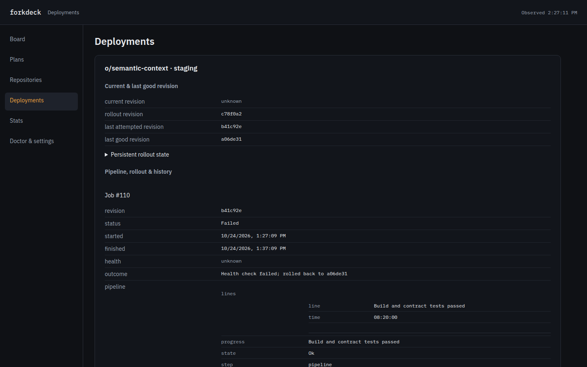

# Operational screens

The browser menu exposes plans, repositories, deployments, stats, and configuration (`/configuration`; the old `/doctor` address redirects there).
All API reads use `Cache-Control: no-store`; [browser writes](web-ui.md) share the native Hub actions.
Optional [OIDC login and group access](web-ui-oidc.md) protects all browser routes when configured.

- `GET /api/v1/snapshot` returns a FlatBuffers `Frame` containing the board `Snapshot`, with `Content-Type: application/octet-stream`. The board retains the received tables and renders their accessors directly.
- `GET /api/v1/live?since=<seq>` opens a WebSocket carrying binary FlatBuffers `Frame` messages. Reconnection resumes from the last received sequence; `Resync` reloads the snapshot and subscribes from its new sequence. The former SSE `/api/v1/events` endpoint is removed. Job details and the pages below still use JSON.
- `GET /api/v1/plans` and `/plans/{id}` retain the native Plan and add `draft_display`, with the task graph fence removed. Markdown disables HTML and images and accepts only HTTP/HTTPS links. Revision markers describe the selected current revision; the Plan structure does not retain older revision bodies.
- `GET /api/v1/repos` projects configured intake labels, automation, poll observations, recorded holds, limits, teammate claims, and plan scheduler observations. A hold describes the last poll, not a fresh admission decision.
- `GET /api/v1/deploys` combines persisted CI/CD state with retained deployment jobs and stage observations. A rollout target or failed attempt is separate from a confirmed current revision. Missing timestamps and health remain unknown.
- `GET /api/v1/stats?days=7` uses the same journal and attempt report as the CLI. Days are bounded to 1–3650. Historical CLI totals and attempt totals remain separate. Cost and queue coverage and nullable percentiles are preserved. Router counters describe this daemon session.
- `GET /api/v1/doctor` returns structured ok/warning/failure observations, redacted effective settings, and the latest 200 action audit entries. Agent versions and router health are the daemon's latest observations; browsing does not make a model request. Repository clone/CLI and MCP tool-list checks are read-only; MCP checks have a five-second bound. External checks are skipped in demo mode and labelled accordingly.
- `GET /api/v1/settings` returns the redacted effective configuration alone. Credentials, tool arguments, environment values, headers, commands, and endpoint URLs are suppressed.

`--demo serve` seeds native Plan, Job, RepoStatus, team, journal, attempt, and Saved deployment structures in `src/server/seed.rs`. Its isolated record source never enters the pending journal-write queue or reads the user's historical usage.

Verification:

The schema is `web/schema/board.fbs`. In `web/`, `npm run schema` regenerates the committed Rust and TypeScript accessors with pinned `flatc` 25.9.23; `npm run schema:check` verifies they match. Ordinary builds use the committed files and do not require `flatc`. The Rust and npm FlatBuffers runtimes are also pinned to 25.9.23.

```sh
cargo clippy --all-targets -- -D warnings
cargo test
cd web
pnpm run check
pnpm run build
cd ..
node tests/web_markdown.mjs
node tests/web_wire.mjs
FORKDECK_WEB_URL=http://127.0.0.1:17420 node tests/web_pages.mjs
```

The browser check needs a demo server with the FlatBuffers snapshot and WebSocket endpoints and a Playwright Chromium installation. `FORKDECK_CHROMIUM` can select an existing Chromium executable. It checks every operational page and Markdown tabs at 1440 px and 390 px, including navigation, overflow, and browser errors; screenshots go to `/tmp`. On the board it also verifies the binary snapshot content type, a live WebSocket, and the absence of SSE requests.



See the [desktop, phone and real-history captures](screenshots/README.md).
