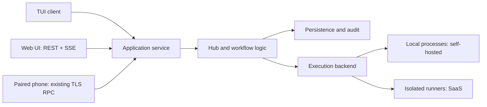

# Forkdeck web UI and server mode plan

Status: proposal, drafted by Codex (read-only review of the code) on 2026-10-22; frontend set to Preact by the user. Not yet approved.

All paths and line references refer to the inspected working tree. Proposed modules and behavior are identified below. No files were edited.

## 1. Scope and stages

**Recommendation:** make `forkdeck serve` the long-lived owner of orchestration; expose the same application operations to the web UI, TUI, and paired phone.

This extends an existing foundation: the hidden `forkdeck remote serve` command already detects agents, restores history, resumes eligible tasks, starts polling/team watchers, serves phones, and performs graceful shutdown. ([src/main.rs:202](/mnt/e/work/Forkdeck/src/main.rs:202), [src/main.rs:525](/mnt/e/work/Forkdeck/src/main.rs:525))

| Stage | Runtime and users | What changes |
|---|---|---|
| Single-user self-hosted | One daemon, one owner, one workspace; SQLite; existing local CLI logins | Add HTTP/static assets, browser authentication, shared application service, and attachable TUI. |
| Team self-hosted | Multiple authenticated members sharing one trusted workspace | Membership, roles, repository permissions, attribution, per-user drafts, concurrent-edit handling. This remains one execution trust domain. |
| Multi-tenant SaaS | Organizations/workspaces served by a control plane; isolated runners execute work | PostgreSQL, durable dispatch/leases, isolated credentials/storage/network, tenant quotas, hosted identity, operational recovery and metering. |

**Design into stage 1:**

- A server-resolved `RequestContext { principal, tenant, workspace, permissions }`; initially one owner and workspace.
- Stable opaque resource IDs, explicit workspace/repository ownership, and tenant-scoped storage interfaces.
- Typed application commands independent of transport and terminal state.
- Durable mutation admission, idempotency keys, revision checks, and audit attribution.
- An execution interface carrying workspace roots, credential references, resource limits, and cancellation.
- Explicit storage roots. Avoid introducing more dependencies on the daemon’s current directory or global environment.
- API capability/version negotiation so clients can evolve independently.

Do not implement distributed scheduling or billing in the first stage. Establish their boundaries.

## 2. Architecture

### Process ownership and TUI migration

Create proposed `src/service.rs` for commands/queries and `src/server/` for daemon lifecycle, HTTP, authentication, and embedded assets.

Keep routing, review, planning, forge coordination, and CI/deploy logic behind this service. `Hub` already owns shared state, agent/build admission, typed-task serialization, repository locks, and history; routing already supports Jev with rules fallback. ([src/orchestrator.rs:22](/mnt/e/work/Forkdeck/src/orchestrator.rs:22), [src/router.rs:15](/mnt/e/work/Forkdeck/src/router.rs:15))

- `forkdeck serve`: acquire an exclusive workspace lease; start one Hub and its background loops. Persistence failure prevents writable server startup.
- Preserve `remote serve` as a compatibility alias.
- Initially retain standalone `forkdeck` with an in-process service adapter.
- Add `forkdeck attach --server …`; its client maintains a read model from snapshots/events and sends typed commands.
- Once parity is proven, make ordinary `forkdeck` attach to the workspace daemon when present; retain explicit standalone mode.
- Closing an attached TUI/browser only disconnects. Daemon shutdown is a separate owner action.

This requires changing lifecycle semantics: the current TUI reads Hub state directly and, when it exits, shuts down jobs and kills child processes. ([src/main.rs:1420](/mnt/e/work/Forkdeck/src/main.rs:1420), [src/main.rs:1562](/mnt/e/work/Forkdeck/src/main.rs:1562))

### API and protocol reuse

**Use REST mutations/queries plus SSE for live updates.** Add an HTTP adapter, preferably Axum, while preserving the existing native phone transport.

Reuse `JobSummary`, `JobDetail`, `StageView`, snapshots, tail offsets, and event semantics from `remote-proto`. They already represent worker/reviewer output, findings, conversations, and routing decisions. ([crates/remote-proto/src/lib.rs:79](/mnt/e/work/Forkdeck/crates/remote-proto/src/lib.rs:79))

Extend the shared DTO layer with Serde serialization and generated TypeScript contracts. Add:

- Full planning/interrupted/choosing states.
- Agent/profile selection, including Copilot.
- Choices, queued messages, supported actions, and resource revision.
- Issue-plan revisions/review/publication progress.
- Task graphs, dependency facts, scheduler errors, and freshness.
- Repository, deploy, diagnostics, and metrics projections.

These are actual protocol gaps: the current agent enum only exposes Auto/Claude/Codex; planning states are collapsed for phones; current calls omit F5/F6 operations. ([crates/remote-proto/src/lib.rs:30](/mnt/e/work/Forkdeck/crates/remote-proto/src/lib.rs:30), [src/remote/view.rs:6](/mnt/e/work/Forkdeck/src/remote/view.rs:6), [crates/remote-proto/src/lib.rs:212](/mnt/e/work/Forkdeck/crates/remote-proto/src/lib.rs:212))

Keep existing Fory registration IDs stable. Introduce a versioned richer protocol with an explicit legacy projection; current `Hello` rejects version mismatches, so changing wire types requires a deliberate migration. ([crates/remote-proto/src/lib.rs:21](/mnt/e/work/Forkdeck/crates/remote-proto/src/lib.rs:21), [src/remote/mod.rs:224](/mnt/e/work/Forkdeck/src/remote/mod.rs:224))

Proposed routes, beneath `/api/v1/workspaces/{workspace}`:

| Routes | Purpose |
|---|---|
| `GET /snapshot`, `/jobs`, `/jobs/{id}` | Initial state, paginated history, detail |
| `GET /events` | Authorized SSE stream |
| `POST /jobs` | Submit with repository/workspace, agent, and planning mode |
| `POST /jobs/{id}/messages`, `/choices`, `/cancel`, `/resume` | Follow-up, queued/immediate steering, decisions, lifecycle |
| `POST /plans`, `/jobs/{id}/plan-actions` | Create/link plans; publish/reconcile; mark eligible plans ready |
| `GET /plans/{id}/tasks` | Task hierarchy, dependencies, PR/build links, scheduler state |
| `GET /repos`, `/deploys`, `/stats`, `/metrics`, `/doctor`, `/settings` | Operational projections |
| `PUT /automation`, `POST /polls` | Pause/resume intake; request a coalesced poll |

Mutations return structured errors and durable operation/job IDs. Require idempotency keys for retryable writes and expected revisions for choices, approval, and settings updates. Resolve workspaces/repositories server-side; clients cannot submit arbitrary host paths, executable names, environment variables, or shell commands.

**Streaming:** promote `remote/feed.rs` into a shared feed owned once per workspace. It already polls state, retains 4,096 events, supports replay, and requests resynchronization when history is unavailable. ([src/remote/feed.rs:18](/mnt/e/work/Forkdeck/src/remote/feed.rs:18), [src/remote/feed.rs:148](/mnt/e/work/Forkdeck/src/remote/feed.rs:148), [src/remote/feed.rs:187](/mnt/e/work/Forkdeck/src/remote/feed.rs:187))

Use snapshot sequence → subscribe-after-sequence; SSE IDs map to the same cursor. Preserve tail replacement rules, bound subscriber queues, send heartbeats, disconnect slow consumers, and resnapshot after gaps or daemon restart. Browser SSE supports reconnection and event IDs. ([src/remote/view.rs:137](/mnt/e/work/Forkdeck/src/remote/view.rs:137), [HTML SSE specification](https://html.spec.whatwg.org/dev/server-sent-events.html))

Add invalidations/events for plan details, repositories, settings, stopping state, and job removal; the current event enum covers jobs, stages, tails, logs, and automation. ([crates/remote-proto/src/lib.rs:199](/mnt/e/work/Forkdeck/crates/remote-proto/src/lib.rs:199))

### Persistence and recovery

**Self-hosted:** retain SQLite/WAL, introducing migrations for workspace ownership, principals/sessions, operations/idempotency, revisions, and audit records. Database access must not block Tokio request threads.

Existing history has migrations, WAL, database-assigned job IDs, and private filesystem permissions. It also has a 200-job retention policy with protection for unresolved plans. ([src/history.rs:21](/mnt/e/work/Forkdeck/src/history.rs:21), [src/history.rs:388](/mnt/e/work/Forkdeck/src/history.rs:388), [src/history.rs:432](/mnt/e/work/Forkdeck/src/history.rs:432), [src/history.rs:678](/mnt/e/work/Forkdeck/src/history.rs:678))

Separate retention for jobs, active plans, audit, and logs. Do not promise complete historical logs from the current bounded-tail representation. Add optional capped log segments with explicit truncation indicators.

Backups must include more than SQLite: deployment state, journal, attempt/queue records, and adaptive state have separate storage today. Scope all of them through a proposed `WorkspaceStorage`. ([src/cicd.rs:452](/mnt/e/work/Forkdeck/src/cicd.rs:452), [src/journal.rs:84](/mnt/e/work/Forkdeck/src/journal.rs:84), [docs/adaptive-routing.md:52](/mnt/e/work/Forkdeck/docs/adaptive-routing.md:52))

**SaaS:** PostgreSQL for transactional state, object storage for logs/artifacts, an outbox for durable dispatch, and runner leases with fencing tokens. Include tenant IDs in keys, uniqueness constraints, and foreign keys; enforce database row policies as defense in depth. API replicas must not independently run the same workspace’s pollers.

Preserve persist-before-forge-write and uncertain-create reconciliation. Restart must not automatically approve or publish plans. These safeguards already exist in planning/sub-issue publication. ([src/planning.rs:153](/mnt/e/work/Forkdeck/src/planning.rs:153), [src/planning.rs:193](/mnt/e/work/Forkdeck/src/planning.rs:193), [src/subissues.rs:22](/mnt/e/work/Forkdeck/src/subissues.rs:22))

### Execution and credentials

Current execution assumes a trusted host user:

- Forge automation uses existing `gh`/`glab` authentication. ([src/issues.rs:1](/mnt/e/work/Forkdeck/src/issues.rs:1))
- Agent CLIs run as child processes; process setup does not clear the inherited environment. ([src/agents.rs:674](/mnt/e/work/Forkdeck/src/agents.rs:674), [src/proc.rs:59](/mnt/e/work/Forkdeck/src/proc.rs:59))
- Checks run through host `sh -c`. ([src/orchestrator.rs:1426](/mnt/e/work/Forkdeck/src/orchestrator.rs:1426))
- Build caches derive from the host home directory. ([src/buildcache.rs:230](/mnt/e/work/Forkdeck/src/buildcache.rs:230))
- Issue jobs already create worktrees on their own branches; typed tasks share a serialized working directory. ([src/issues.rs:762](/mnt/e/work/Forkdeck/src/issues.rs:762), [src/orchestrator.rs:26](/mnt/e/work/Forkdeck/src/orchestrator.rs:26))

Retain those conveniences for single-user hosting, with explicit configured roots.

Before admitting unrelated SaaS tenants:

- Introduce proposed `ExecutionBackend` and `ForgeClient` boundaries.
- Run agents, checks, package installation, Git hooks, and repository-controlled tooling inside isolated runners.
- Use tenant-specific clones, worktrees, homes, CLI sessions, temporary directories, caches, and credential stores.
- Keep forge publication and deployment credentials in trusted broker operations; agents receive only narrowly scoped access they require.
- Never switch credentials by mutating process-global `HOME` or environment.
- Use short-lived repository tokens and provider-supported agent credentials; do not copy personal host login directories into a shared service.

## 3. Security model

**Authentication**

Preserve native phone TLS/pairing: its CA, certificate registry, hashed one-time pairing codes, and live revocation checks are useful existing mechanisms. ([src/remote/pki.rs:53](/mnt/e/work/Forkdeck/src/remote/pki.rs:53), [src/remote/pair.rs:85](/mnt/e/work/Forkdeck/src/remote/pair.rs:85), [src/remote/devices.rs:22](/mnt/e/work/Forkdeck/src/remote/devices.rs:22), [src/remote/mod.rs:177](/mnt/e/work/Forkdeck/src/remote/mod.rs:177))

For browsers:

- Default HTTP binding to loopback; local CLI creates a short-lived, one-use browser login code.
- Exchange the code for a revocable HttpOnly session cookie. Store token hashes; never place long-lived credentials in URLs or browser storage.
- Use trusted HTTPS for LAN/public browser access. Keep native CA pinning separate from browser certificate trust.
- CLI/TUI clients use revocable scoped bearer tokens stored in private files or an OS credential store.

For SaaS, add OIDC or GitHub OAuth with state/PKCE validation. Separate sign-in identity from repository authorization; use repository installation credentials rather than treating the login token as universal forge access.

**Authorization**

Enforce permissions inside the application service, including native phone calls:

| Role | Permissions |
|---|---|
| Viewer | Read authorized repositories, jobs, logs, plans, and metrics |
| Operator | Submit, reply, choose, cancel, retry, and publish approved plans |
| Owner/admin | Manage membership, credentials, automation policy, integrations, and settings |

Treat production deployment as a separate capability. Scope snapshots, streams, searches, metrics, artifacts, and error messages; tenant IDs and event cursors confer no access. Revoking membership/session must terminate active streams.

**Execution isolation**

Agent CLI sandboxes remain an inner defense, not the SaaS boundary. Preserve existing reviewer scratch-directory protections and worker sandbox arguments. ([src/agents.rs:649](/mnt/e/work/Forkdeck/src/agents.rs:649), [src/agents.rs:691](/mnt/e/work/Forkdeck/src/agents.rs:691))

Use rootless constrained containers for trusted installations; require dedicated VMs or microVM isolation for hostile multi-tenant execution. Apply CPU/memory/PID/disk/time quotas, restricted mounts, egress policy, metadata-network blocking, and no host/container-runtime sockets. Firecracker is one candidate designed for multi-tenant workload isolation. ([Firecracker design](https://github.com/firecracker-microvm/firecracker/blob/main/docs/design.md))

**Web and secrets**

- Same-origin UI/API; CORS disabled by default. Explicit development origins only.
- HttpOnly/Secure/SameSite cookies plus CSRF token and Origin validation for mutations; no state-changing GETs. SameSite alone is insufficient. ([OWASP CSRF guidance](https://cheatsheetseries.owasp.org/cheatsheets/Cross-Site_Request_Forgery_Prevention_Cheat_Sheet.html))
- Escape logs/diffs; sanitize rendered Markdown; disable raw HTML and unsafe links. Restrictive CSP and framing policy.
- Secret references in settings, encrypted secrets at rest for hosted deployments, short-lived runner delivery, and redaction before persistence/streaming.
- Validate integration endpoints against SSRF and DNS-rebinding threats; separate runner package egress from control-plane integration access.
- Append-only audit events: actor, workspace, action, target, revision, result, request ID, timestamp. Exclude secret values and raw prompts.
- Bound login attempts, requests, streams, payload sizes, poll frequency, jobs, log volume, and tenant concurrency. Add fair scheduling and durable budget reservations.

**Never expose:** CA/private keys, pairing secrets, CLI login/session files, raw environment/configuration, unrestricted MCP tools, arbitrary filesystem access, host shell/PTY, database files, control-plane credentials, or another tenant’s caches/logs.

## 4. Web UI

**Stack (decided: Preact):** Preact + TypeScript, built with Vite (`@preact/preset-vite`). Routing with `preact-iso` (lazy routes, small); live state in `@preact/signals`: the SSE event reducer writes signals, so a streaming log or a job card re-renders alone instead of the whole board. Ordinary CSS and accessible components, no UI kit. Preact's ~4 KB runtime keeps the bundle small, which suits embedding it in the Rust binary (`rust-embed` or `include_dir`, under proposed `src/server/assets.rs`). Node is a development/build dependency only: release CI builds `web/dist` and the binary embeds it; a debug build may serve `web/dist` from disk for fast iteration. Use `preact/compat` only if a specific library demands it; prefer libraries that work with Preact directly. Vite produces a deployable static bundle. ([Vite production builds](https://vite.dev/guide/build))

Serve hashed assets with immutable caching, index HTML with revalidation, and no external CDN dependency. Generate TypeScript contracts from shared DTOs and verify drift in CI.

| Screen | Behavior and existing mapping |
|---|---|
| **Factory board/jobs** | Queue, Build, Review, Delivery, Done, Attention; repository/status filters, search, pagination, selection and deep links. Preserve TUI lane mapping. ([src/ui.rs:240](/mnt/e/work/Forkdeck/src/ui.rs:240)) |
| **Job detail** | Worker/reviewer live logs, routing explanation, checks/findings, usage, conversation, queued messages, cancellation/resume, and authorized diffs. Shared detail DTOs provide the starting projection. ([src/remote/view.rs:96](/mnt/e/work/Forkdeck/src/remote/view.rs:96)) |
| **Task composer** | Explicit New task/Reply target; repository/workspace selector; auto or agent/profile selection; Plan first toggle; queued message versus Send now. Preserve typed-task interaction semantics. ([src/main.rs:1208](/mnt/e/work/Forkdeck/src/main.rs:1208), [README.md:1050](/mnt/e/work/Forkdeck/README.md:1050)) |
| **Choices — F5** | Recommended option cards and custom response; submit against the displayed job/revision. Reuse the existing choice parser/application behavior. ([src/main.rs:1248](/mnt/e/work/Forkdeck/src/main.rs:1248), [src/main.rs:1283](/mnt/e/work/Forkdeck/src/main.rs:1283)) |
| **Issue planning — F6** | Repository and optional issue reference; draft/review tabs; revision status; Accept/publish/reconcile, Refine, Ready for build. These actions already flow through Hub. ([src/plan_ui.rs:23](/mnt/e/work/Forkdeck/src/plan_ui.rs:23), [src/plan_ui.rs:86](/mnt/e/work/Forkdeck/src/plan_ui.rs:86)) |
| **Sub-issue task lists** | Nested groups/work/decisions; real issue numbers, blockers, acceptance checks, PR/build links, unknown/stale status, and publication progress. Use existing graph/materialization/scheduler logic. ([src/taskgraph.rs:10](/mnt/e/work/Forkdeck/src/taskgraph.rs:10), [src/subissues.rs:141](/mnt/e/work/Forkdeck/src/subissues.rs:141), [src/schedule.rs:24](/mnt/e/work/Forkdeck/src/schedule.rs:24)) |
| **Repositories/automation/team** | Intake state, polling errors, claims, author/budget constraints, and agent availability; pause/resume and poll-now controls. ([src/issues.rs:483](/mnt/e/work/Forkdeck/src/issues.rs:483), [src/team.rs:815](/mnt/e/work/Forkdeck/src/team.rs:815)) |
| **Deployments** | Environment/revision, CI progress, deployment/health/rollback state, last good revision and failures. Initially expose existing pipeline state; add manual controls only with explicit policy. ([src/cicd.rs:433](/mnt/e/work/Forkdeck/src/cicd.rs:433), [src/cicd.rs:760](/mnt/e/work/Forkdeck/src/cicd.rs:760)) |
| **Stats/metrics** | Job outcomes, reported model/effort/role, token/cost coverage, queue/latency percentiles, and adaptive status. Preserve unknown values and denominators; metrics are not an invoice. ([src/metrics.rs:305](/mnt/e/work/Forkdeck/src/metrics.rs:305), [docs/model-metrics-plan.md:20](/mnt/e/work/Forkdeck/docs/model-metrics-plan.md:20)) |
| **Doctor/settings** | Structured diagnostics, sandbox capability, integration health, paired devices/sessions, retention and safe settings. Extract diagnostics from CLI output; return redacted settings DTOs. ([src/main.rs:881](/mnt/e/work/Forkdeck/src/main.rs:881)) |

Two workflow distinctions must remain visible:

- A single-issue plan requires Ready for build after publication; a task-list plan materializes sub-issues and schedules eligible tasks automatically. ([src/planning.rs:125](/mnt/e/work/Forkdeck/src/planning.rs:125), [src/subissues.rs:163](/mnt/e/work/Forkdeck/src/subissues.rs:163))
- Adoption, graph-changing re-plans, and comment-driven decision workflows belong to later sub-issue plans; do not present them as complete capabilities. ([docs/superpowers/plans/2026-10-21-plans-to-sub-issues-core.md:15](/mnt/e/work/Forkdeck/docs/superpowers/plans/2026-10-21-plans-to-sub-issues-core.md:15))

**Mobile:** use a compact list instead of six horizontal lanes, tabbed worker/reviewer output, sticky composer/actions, large touch targets, and an explicit auto-follow toggle. Show connection freshness and reconnect state. Support keyboard navigation and screen readers. Exclude offline mutations from the first release.

## 5. Delivery milestones

Each milestone ships independently; proposed paths below do not exist yet unless already cited.

| Milestone | Deliverable and touched modules | Tests proving completion |
|---|---|---|
| **1. Small daemon extraction** | Promote `remote serve` to `serve`; extract common startup/shutdown into proposed `src/server/runtime.rs`; workspace ownership lock. Touch `main.rs`, `orchestrator.rs`, `remote/mod.rs`, README. No web mutations yet. | Extend `tests/remote.rs`: both commands work; second daemon refuses ownership; restart restores eligible work; SIGTERM performs cleanup. |
| **2. Shared service and read-only web** | Proposed `service.rs`, `server/http.rs`, `server/auth.rs`, `server/assets.rs`, `web/`; shared feed; authenticated board/detail/logs; workspace context; Serde/TypeScript DTO contracts. Touch remote adapter, feed/view, protocol crate, Cargo/config/example. | Legacy phone tests; denied unauthenticated reads; one-use login/session revocation; snapshot/SSE race, replay, lag and restart resync; slow-consumer bounds; packaged binary serves assets without Node. |
| **3. Writable web MVP** | Submit/reply/steer/choose/cancel/resume; plan-first; automation controls; durable operations/idempotency/revisions/audit. Touch service, HTTP, history, choices, orchestrator and composer UI. | Fake-agent end-to-end task/review/fix; duplicate POST creates one job/message; stale choice rejected; failed admission persistence launches nothing; CSRF/CORS tests; refresh/disconnect preserves jobs. |
| **4. Planning and operational parity** | F6, sub-issue lists, scheduler projection, repositories/team, deploy status, metrics, doctor and safe settings. Touch planning/taskgraph/subissues/schedule/tracker/cicd/metrics/journal/config and web screens. | Extend fake-forge fixtures: partial publication recovery, no duplicate issues, dependency merge gating, closed-unmerged PR blocking, unknown forge state, manual list edits, paused intake. UI tests for approval invalidation and nullable metrics. |
| **5. TUI client and team self-hosting** | Proposed client/read-model modules; `attach`; in-process service adapter; memberships, roles and per-user drafts. Refactor `main.rs`, `ui.rs`, `plan_ui.rs`, `diff.rs`, protocol client and history. | Existing PTY tests plus attached variants; two clients see consistent state; client exit leaves daemon jobs running; role matrix; concurrent approvals; revoked sessions/streams; backup/restore drill. |
| **6. Hosted tenant pilot** | Proposed storage/execution/forge adapters and runner protocol; PostgreSQL/outbox/leases; OIDC/GitHub identity; isolated runners/secrets; tenant quotas and retention. Touch execution paths in agents/proc/checks, forge/team/tracker, caches, persistence and deployment adapters. | Two tenants with identical repo/job names cannot read or affect each other; credential/cache/mount/network isolation; stale runner fenced; crash/redelivery recovery; quota fairness; tenant export/delete and restore tests. Security review before unrelated tenants execute. |

Use the existing automation, remote, metrics, and PTY suites as regression foundations. Run Clippy and Rust tests at implementation gates, plus frontend contract/component/browser tests as introduced. The repository’s implementation guidance explicitly requires hand formatting rather than `cargo fmt`. ([README.md:1042](/mnt/e/work/Forkdeck/README.md:1042), [docs/superpowers/plans/2026-10-21-plans-to-sub-issues-core.md:19](/mnt/e/work/Forkdeck/docs/superpowers/plans/2026-10-21-plans-to-sub-issues-core.md:19))

## 6. Risks and explicit decisions

| Decision or risk | Recommendation |
|---|---|
| **Where does hosted execution happen?** | Start the hosted pilot with customer-owned isolated runners. Offer managed microVM runners after isolation and supported agent-authentication paths are proven. |
| **Personal CLI subscriptions in SaaS** | Treat unattended hosted authentication and commercial terms as launch gates. Keep local login support for self-hosting; require provider-supported credentials for managed execution. |
| **Tenant boundary** | Organization owns workspaces; workspace owns repos/jobs/plans/integrations. Do not equate a user login with a tenant. |
| **Typed tasks: current directory or worktrees?** | Preserve current-directory execution for explicitly configured self-hosted workspaces. Default hosted tasks to isolated worktrees; persist workspace identity across follow-ups. |
| **When does the TUI become a client?** | Keep the in-process adapter through web parity; complete attached-TUI support before hosted launch. |
| **Phone compatibility** | Maintain the existing transport/projection during migration; publish an explicit protocol-version policy before extending wire types. |
| **GitLab scope** | Preserve ordinary GitLab jobs/planning; keep sub-issue features capability-gated. Materialization currently explicitly rejects GitLab. ([src/subissues.rs:144](/mnt/e/work/Forkdeck/src/subissues.rs:144)) |
| **Forge concurrency and duplicate effects** | Serialize operations per plan/repository, retain durable reconciliation, and acknowledge that local database transactions cannot make forge writes atomic. |
| **Deployment authority** | Keep credentials and deployment operations outside untrusted runners; require a separate production-deploy permission. |
| **Logs and retention** | Default to capped redacted logs with clear coverage; choose retention duration and hosted storage budget before pilot. |
| **Usage and pricing** | Separate operational metrics from billing. Unknown/partial usage remains visible; do not advertise hard spending caps without provider enforcement. Existing docs describe adapter limitations. ([docs/adaptive-routing.md:269](/mnt/e/work/Forkdeck/docs/adaptive-routing.md:269)) |
| **Hosted availability target** | Begin with one active scheduler per workspace and documented recovery objectives. Add HA through leases/fencing after recovery tests pass. |
| **Frontend choice** | Decided: Preact + TypeScript + Vite, `preact-iso`, `@preact/signals`, assets embedded in the binary; Node only at build time. |
| **Sub-issue roadmap breadth** | Ship visualization and existing core operations first. Track adoption, graph-changing re-plans, and durable human-question handling as separate backend milestones. |
| **Integration maturity** | Require scratch-repository and real CI/deploy validation before production commitments; README currently records stand-in testing and live-integration gaps. ([README.md:1103](/mnt/e/work/Forkdeck/README.md:1103)) |